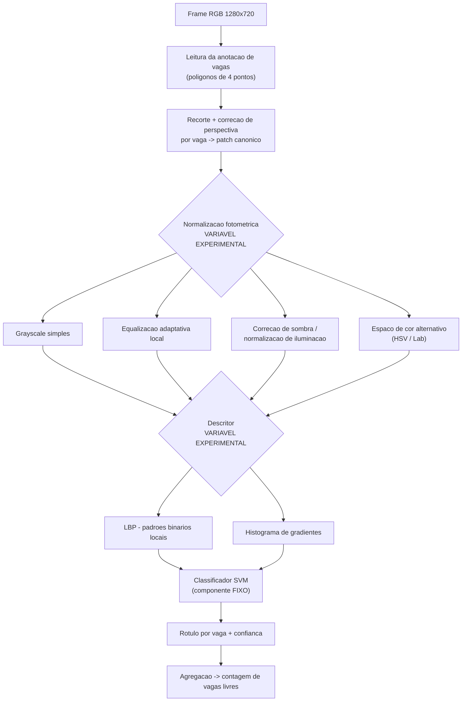
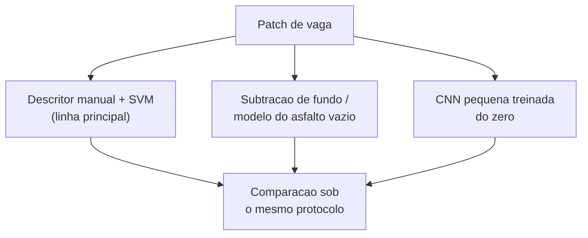
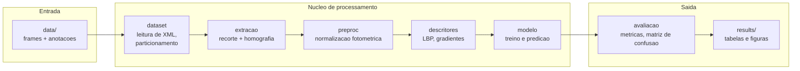

# Proposta Técnica — Projeto Aplicado Longitudinal

**Disciplina:** Processamento de Imagens — 2026/02
**Etapa:** M1
**Autoria:** Leonardo Pacheco _(composição da equipe ainda em definição; ver `README.md`)_
**Última revisão:** 2026-08-29

---

## 1. Problema

### 1.1 Situação inicial

Estacionamentos de grande porte — campi universitários, shoppings, aeroportos, estacionamentos
públicos — precisam saber, a qualquer momento, **quais vagas estão livres**. A alternativa
tradicional é instrumentar cada vaga individualmente com um sensor (ultrassônico, magnético ou
indutivo). Essa abordagem funciona, mas o custo e a manutenção crescem linearmente com o número
de vagas, e a instalação exige intervenção física no piso.

Uma única câmera fixa, posicionada num ponto elevado, já cobre dezenas ou centenas de vagas
simultaneamente. O custo por vaga passa a ser marginal. O problema deixa de ser de instrumentação
e passa a ser de **interpretação da imagem**.

### 1.2 Por que isso é um problema de Processamento Digital de Imagens

A informação desejada — "esta vaga está ocupada ou livre" — não está explicitamente presente na
imagem. Ela precisa ser inferida a partir da aparência de uma região do frame. E essa aparência
varia enormemente por razões que **nada têm a ver com a ocupação da vaga**:

| Fator de variação | Efeito observado nas imagens |
|---|---|
| Hora do dia e posição do sol | Sombras longas que atravessam vagas vazias e as escurecem como se houvesse um veículo |
| Condição do céu | Sol direto satura o asfalto claro; dia nublado achata o contraste global |
| Chuva | Asfalto molhado fica espelhado e escuro; gotas na lente borram regiões inteiras |
| Perspectiva | Vagas próximas à câmera aparecem grandes e quase frontais; vagas distantes são pequenas e fortemente obliquadas |
| Oclusão | Árvores, postes e veículos altos em fileiras da frente cobrem parcialmente vagas ao fundo |
| Cor do veículo | Um carro branco sobre asfalto claro tem contraste quase nulo com a vaga vazia |

Ou seja, o sinal que queremos (presença de veículo) está misturado com ruído fotométrico e
geométrico de magnitude comparável. **Separar esses dois componentes é exatamente o que o
processamento de imagens faz.** O problema não é resolvido por uma regra de brilho ou por uma
subtração de fundo ingênua, e é por isso que ele sustenta uma investigação de um semestre.

### 1.3 Delimitação — o que está dentro e fora do escopo

**Dentro do escopo:**

- Câmera **fixa**, com geometria conhecida e estável ao longo do tempo.
- As posições das vagas são **conhecidas a priori** (fornecidas como polígonos anotados). Não é
  objetivo deste projeto descobrir automaticamente onde ficam as vagas.
- Classificação **binária** por vaga: ocupada ou livre.
- Condições diurnas (o conjunto de dados adotado não cobre período noturno).

**Fora do escopo:**

- Identificação do veículo, leitura de placa, ou rastreamento entre frames.
- Detecção de manobras, tempo de permanência ou cobrança.
- Descoberta automática do layout de vagas.
- Vídeo em tempo real — o projeto trabalha sobre frames independentes.

### 1.4 A pergunta técnica central

Uma solução que funciona apenas no estacionamento e no clima em que foi calibrada tem pouco valor
prático: significa recalibrar a cada nova instalação. O trabalho original que originou o conjunto
de dados adotado (Almeida et al., 2015) já reportava que o desempenho **cai quando o classificador
treinado em um estacionamento é aplicado a outro**.

Este projeto assume essa limitação como objeto de estudo:

> **Quanto da queda de desempenho entre condições climáticas distintas e entre estacionamentos
> distintos pode ser recuperada por pré-processamento fotométrico e por escolha de descritores de
> textura, em vez de simplesmente ampliar o conjunto de treino?**

Essa formulação é deliberada: ela mantém o classificador como componente fixo e coloca as
**etapas de processamento de imagem como a variável experimental**. É o que torna o projeto um
trabalho de PDI, e não um exercício de aprendizado de máquina em que a imagem é apenas um vetor
de entrada.

---

## 2. Contexto de aplicação

O cenário de referência é o de um campus universitário ou estacionamento corporativo que já possui
câmeras de segurança instaladas em pontos elevados. A proposta é reaproveitar essa infraestrutura
para produzir uma contagem de vagas livres, exibida em painel na entrada ou disponibilizada via
API.

O que torna o contexto concreto o suficiente para avaliar resultados:

- Existe um número de referência verificável (a contagem real de vagas livres).
- O custo de erro é assimétrico e interpretável: indicar como livre uma vaga ocupada faz o
  motorista se deslocar em vão; o inverso apenas subutiliza o estacionamento. Isso justifica
  analisar falsos positivos e falsos negativos separadamente, e não apenas a acurácia agregada.
- O requisito de generalização é real: quem instala o sistema num estacionamento quer instalar no
  seguinte sem recomeçar a anotação.

O projeto **não pretende** entregar um produto comercial. Pretende produzir evidência mensurável
sobre quais técnicas de processamento tornam essa leitura confiável sob variação de condições.

---

## 3. Objetivos

### 3.1 Objetivo geral

Investigar e avaliar experimentalmente um pipeline de processamento digital de imagens capaz de
classificar a ocupação de vagas de estacionamento a partir de frames de câmera fixa, quantificando
o impacto das etapas de normalização fotométrica e de representação por textura sobre a robustez a
mudanças de clima e de estacionamento.

### 3.2 Objetivos específicos

1. Construir um extrator que, dado um frame e a anotação de vagas, produza recortes normalizados
   por vaga com correção de perspectiva.
2. Caracterizar quantitativamente a variabilidade fotométrica do conjunto de dados (distribuições
   de intensidade por clima, por estacionamento e por classe).
3. Implementar e comparar ao menos três estratégias de normalização fotométrica.
4. Implementar e comparar ao menos dois descritores de textura.
5. Estabelecer um protocolo de avaliação com separação explícita entre os cenários
   intra-estacionamento e inter-estacionamento.
6. Medir e interpretar a degradação de desempenho em cada cenário, isolando a contribuição de cada
   etapa do pipeline por meio de ablação.

### 3.3 Entrada e saída

**Entrada:**

- Um frame RGB de 1280×720 px proveniente de câmera fixa.
- Um arquivo de definição de vagas para aquela câmera: para cada vaga, um identificador e um
  polígono de quatro pontos em coordenadas de imagem.

**Saída:**

- Para cada vaga: identificador, rótulo `ocupada` | `livre`, e um escore de confiança.
- Para o frame: contagem agregada de vagas livres.
- Opcionalmente, uma imagem de visualização com os polígonos coloridos por classe predita, usada
  para inspeção qualitativa e para o relatório.

```text
frame.jpg  +  vagas.xml
        │
        ▼
   [ pipeline ]
        │
        ▼
  { "vagas": [ {"id": 1, "estado": "ocupada", "conf": 0.97}, ... ],
    "livres": 23, "total": 40 }
```

### 3.4 Critérios de sucesso

Os critérios abaixo são a base contra a qual o resultado final será julgado. Os limiares numéricos
são metas iniciais e poderão ser revistos na M2 à luz dos primeiros resultados — mas a **forma** dos
critérios não deve mudar.

| # | Critério | Como será verificado |
|---|---|---|
| C1 | Acurácia por vaga ≥ 90% no cenário intra-estacionamento (treino e teste no mesmo lote, dias disjuntos) | Acurácia sobre o conjunto de teste, reportada por clima |
| C2 | A queda de acurácia no cenário inter-estacionamento é **menor** com normalização fotométrica do que sem ela | Comparação direta entre as duas configurações, mesma partição |
| C3 | Desempenho reportado **sempre desagregado** por clima (Sunny / Cloudy / Rainy), nunca apenas em média | Tabela de resultados por condição |
| C4 | Falsos positivos e falsos negativos reportados separadamente | Matriz de confusão por cenário |
| C5 | Todo resultado numérico apresentado é reproduzível a partir do repositório | Script executável por linha de comando, com semente fixa e parâmetros explícitos |

O critério C2 é o coração do projeto: ele pode ser refutado pelos dados. Se a normalização
fotométrica **não** recuperar desempenho, esse é um resultado legítimo e será reportado como tal,
acompanhado da investigação sobre o porquê.

---

## 4. Pipeline preliminar



### 4.1 Finalidade de cada etapa

**Recorte e correção de perspectiva.**
*Recebe:* frame completo e um polígono de quatro pontos.
*Produz:* uma imagem de tamanho canônico fixo (previsto: 48×64 px) contendo apenas a vaga.
*Finalidade:* eliminar a variação geométrica. Sem esta etapa, uma vaga distante e outra próxima
produzem representações incomparáveis, e o classificador aprenderia a posição na imagem em vez da
presença do veículo. A transformação prevista é uma homografia estimada a partir dos quatro
vértices do polígono.
*Dúvida em aberto:* qual o tamanho canônico adequado. Muito pequeno destrói a textura que os
descritores exploram; muito grande amplia artificialmente vagas distantes, que têm pouca
informação real.

**Normalização fotométrica.**
*Recebe:* patch canônico em cor.
*Produz:* patch com variação de iluminação atenuada.
*Finalidade:* esta é a etapa sob investigação. A hipótese do projeto é que a queda de desempenho
entre climas e entre estacionamentos é majoritariamente de origem fotométrica, e portanto
atacável aqui. As alternativas listadas no diagrama serão implementadas e comparadas, não
escolhidas a priori.
*Dúvida em aberto:* se a informação de cor ajuda ou atrapalha. Cor distingue veículo de asfalto em
dia claro, mas é justamente o canal mais afetado por chuva e sombra.

**Descritor de textura.**
*Recebe:* patch normalizado.
*Produz:* vetor de características de dimensão fixa.
*Finalidade:* representar a região por propriedades locais de textura e borda em vez de por
intensidade bruta. Um veículo introduz bordas, reflexos e descontinuidades que o asfalto vazio não
tem — mesmo quando o brilho médio das duas regiões é semelhante. É o que deve tornar o carro
branco sobre asfalto claro separável.
*Dúvida em aberto:* se descritores clássicos bastam ou se será necessário recorrer a
representações aprendidas na M3.

**Classificador.**
*Recebe:* vetor de características.
*Produz:* rótulo e escore.
*Finalidade:* deliberadamente mantido **fixo e simples** (SVM) durante todo o projeto. Se o
classificador variasse junto com o pré-processamento, seria impossível atribuir as diferenças de
desempenho às etapas de imagem — e o projeto perderia seu objeto de estudo.

**Agregação.**
*Recebe:* rótulos individuais das vagas de um frame.
*Produz:* contagem de vagas livres.
*Finalidade:* produzir a saída que o contexto de aplicação de fato consome, e permitir avaliar o
erro na métrica que importa ao usuário final (erro na contagem), além da acurácia por vaga.

### 4.2 Alternativas reconhecidas

O pipeline acima não é a única abordagem possível. Duas alternativas foram consideradas e estão
registradas aqui porque poderão ser retomadas na M2 ou M3:



- **Subtração de fundo.** Como a câmera é fixa, seria possível modelar a aparência da vaga vazia e
  detectar desvios. Atraente pela simplicidade, mas frágil justamente sob os fatores que este
  projeto quer estudar: sombras móveis e asfalto molhado produzem desvios grandes sem qualquer
  veículo presente. Registrada como baseline de comparação, não como linha principal.
- **Representação aprendida (CNN).** Provavelmente superior em acurácia bruta, mas transferiria o
  objeto de estudo do processamento de imagens para a arquitetura da rede. Prevista para a M3 como
  **ponto de comparação** contra a linha clássica, permitindo discutir o custo-benefício entre as
  duas famílias.

Na M1, reconhecer essas alternativas é mais relevante do que decidir prematuramente por uma.

---

## 5. Arquitetura preliminar da solução

Organização modular prevista, compatível com o estágio atual do projeto:



O princípio da separação: `preproc` e `descritores` expõem interfaces uniformes, de modo que
trocar uma estratégia por outra seja uma mudança de parâmetro de configuração, não de código. Isso
é o que viabiliza os experimentos de ablação previstos sem duplicar o pipeline.

Nenhuma persistência em banco de dados está prevista. Resultados são arquivos versionáveis
(CSV para métricas, PNG para figuras).

---

## 6. Conjunto de imagens

O conjunto adotado é o **PKLot**, produzido pela UFPR e pela PUCPR. Sua caracterização completa —
origem, licença, citação obrigatória, contagens verificadas na cópia local, formato das anotações
e condições de uso — está em **[`dados.md`](dados.md)**.

Resumo para leitura desta proposta:

- Frames de 1280×720 px de três estacionamentos distintos (PUCPR, UFPR04, UFPR05).
- Rotulados por condição climática: Sunny, Cloudy, Rainy.
- Anotação por vaga em XML, com polígono de quatro pontos, retângulo rotacionado e rótulo de
  ocupação — ou seja, **verdade de referência disponível sem esforço de anotação manual**.
- Licença Creative Commons Attribution 4.0, com exigência de citação do artigo original.

A existência de três estacionamentos distintos é o que viabiliza diretamente o experimento
inter-estacionamento descrito na seção 3. A estratificação por clima viabiliza o experimento de
robustez climática. O conjunto foi escolhido por essas duas propriedades, não apenas por
disponibilidade.

---

## 7. Estudo de viabilidade — M1

### 7.1 Evidências já obtidas

- **Conjunto de dados obtido e inspecionado localmente.** Estrutura de diretórios, formato das
  anotações e contagens por estacionamento e clima verificados diretamente nos arquivos. Números
  em [`dados.md`](dados.md).
- **Verdade de referência confirmada.** O formato XML foi lido e validado: cada vaga traz polígono
  e rótulo de ocupação, o que elimina o risco de o projeto travar por falta de anotação.
- **Fatores de dificuldade confirmados por inspeção visual.** A análise das imagens confirmou a
  presença simultânea, em um mesmo frame, de perspectiva acentuada, oclusão por vegetação, sombras
  e veículos de baixo contraste contra o pavimento. Ver `images/results/`.
- **Baseline publicado existente.** O artigo original reporta resultados com descritores de textura
  e SVM, oferecendo referência metodológica e ponto de comparação.

### 7.2 Experimentos previstos para fechar a M1

| # | Experimento | Evidência que produz |
|---|---|---|
| E1 | Parser de anotação + extração de recortes com correção de perspectiva | Demonstra que a etapa geométrica é executável; produz painel visual de recortes por clima |
| E2 | Caracterização fotométrica: histogramas de intensidade por clima e por classe | Quantifica a sobreposição entre classes e sustenta a hipótese central do projeto |
| E3 | Baseline mensurável: descritor de textura + SVM, treino e teste no mesmo estacionamento | Estabelece o limite superior de referência (cenário fácil) |
| E4 | Mesmo classificador de E3 aplicado a um estacionamento diferente | **Quantifica o problema**: a diferença entre E3 e E4 é a justificativa numérica do projeto |

A diferença entre E3 e E4 é o resultado mais importante da M1. Ela transforma a afirmação
"generalizar entre estacionamentos é difícil" em um número medido pelo próprio grupo.

### 7.3 Riscos identificados

| Risco | Mitigação prevista |
|---|---|
| Extração local do conjunto aparentemente incompleta (ver `dados.md`) | Reextrair e reconferir; o subconjunto atual já é suficiente para a M1 |
| Volume de recortes elevado torna a experimentação lenta | Amostragem estratificada por dia, clima e classe; caching dos vetores de características |
| Desbalanceamento entre classes varia por clima e lote | Reportar métricas balanceadas além da acurácia; considerar reamostragem |
| Vagas fortemente ocluídas podem ser irrecuperáveis | Analisar erros por posição na imagem; se confirmado, documentar como limitação, não mascarar |
| Sem equipe definida, o escopo pode ficar grande demais | Escopo dimensionado para uma pessoa; extensões marcadas explicitamente como opcionais |

---

## 8. Evolução prevista

A M2 e a M3 ainda não foram detalhadas pelo professor. O planejamento abaixo é uma hipótese de
trabalho do grupo e será ajustado quando os enunciados forem publicados.

| Etapa | Foco | Entrega prevista |
|---|---|---|
| **M1** | Definição, dados, viabilidade | Problema delimitado, conjunto caracterizado, pipeline projetado, E1–E4 executados |
| **M2** | Pipeline completo e ablação | Normalizações e descritores implementados; tabela de ablação sob protocolo fixo; análise de erros |
| **M3** | Consolidação e comparação | Melhor configuração consolidada, comparação com abordagem alternativa, CLI reprodutível, análise final |

---

## 9. Referências

1. ALMEIDA, P. R. L.; OLIVEIRA, L. S.; BRITTO JR., A. S.; SILVA JR., E. J.; KOERICH, A. L.
   **PKLot — A robust dataset for parking lot classification.** *Expert Systems with Applications*,
   v. 42, n. 11, p. 4937–4949, 2015.
   Disponível em: <https://www.inf.ufpr.br/lesoliveira/download/ESWA2015.pdf>

2. Laboratório Visão Robótica e Imagem (VRI) — UFPR. **Parking Lot Database.**
   Disponível em: <https://web.inf.ufpr.br/vri/databases/parking-lot-database/>

3. GONZALEZ, R. C.; WOODS, R. E. **Digital Image Processing.** 4. ed. Pearson, 2018.
   _(referência de base para as operações de realce, normalização e análise de textura)_

> Referências adicionais sobre descritores de textura e normalização de iluminação serão
> incorporadas conforme a investigação avançar na M2.

---

## 10. Registro de decisões

| Data | Decisão | Justificativa |
|---|---|---|
| 2026-08-29 | Adoção do PKLot em vez de conjunto de recibos digitalizados | Os recibos disponíveis já vinham digitalizados, recortados e alinhados, o que removia a motivação para as etapas de processamento geométrico e fotométrico. O PKLot apresenta variação real e traz verdade de referência embutida. |
| 2026-08-29 | Classificador mantido fixo ao longo do projeto | Permite atribuir variações de desempenho às etapas de processamento de imagem, preservando o objeto de estudo. |
| 2026-08-29 | Posição das vagas tratada como conhecida a priori | A descoberta automática do layout é um problema distinto e ampliaria demais o escopo para um projeto de um semestre. |
