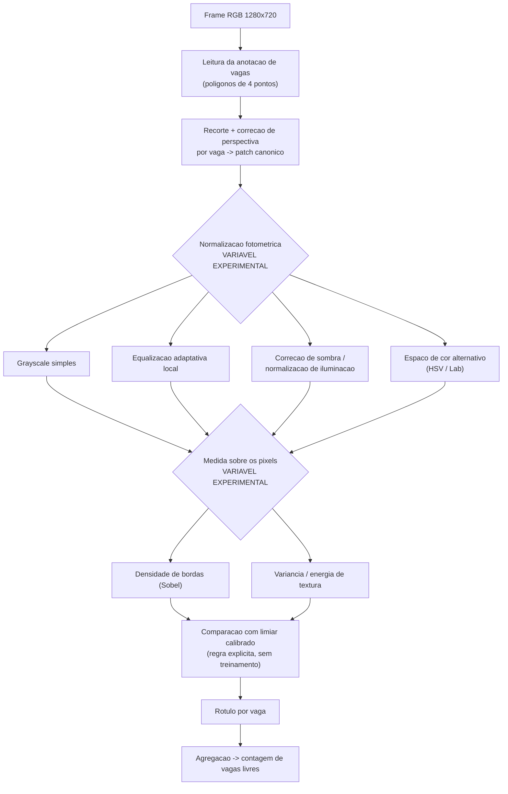
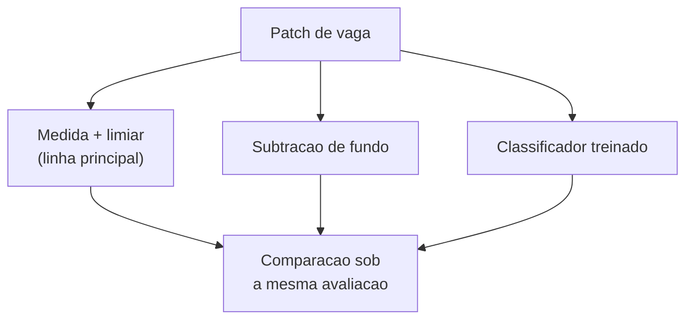
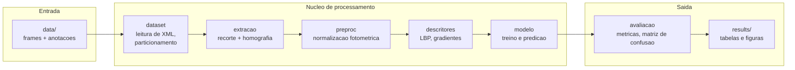

# Proposta Técnica — Projeto Aplicado Longitudinal

**Disciplina:** Processamento de Imagens — 2026/02
**Etapa:** M1
**Autoria:** Leonardo Pacheco _(composição da equipe ainda em definição; ver `README.md`)_
**Última revisão:** 2026-08-29

---

## 1. Problema

### 1.1 Situação inicial

Estacionamentos de grande porte precisam saber, a qualquer momento, **quais vagas estão livres**.
A alternativa tradicional é instrumentar cada vaga com um sensor. Isso é viável em estacionamentos
cobertos e estruturados, como os de shopping centers, onde há teto para fixar sensores, energia
disponível e ambiente protegido.

Em **estacionamentos abertos** a situação é outra: a instalação exige intervenção no piso, os
sensores ficam expostos a chuva, sol e passagem de veículos, e o custo de implantação e manutenção
cresce proporcionalmente ao número de vagas.

Uma única câmera fixa em ponto elevado cobre dezenas ou centenas de vagas simultaneamente, e muitas
vezes já existe no local por razões de segurança. O custo por vaga passa a ser marginal — mas o
problema deixa de ser de instrumentação e passa a ser de **interpretação da imagem**.

### 1.2 Por que isso é um problema de Processamento Digital de Imagens

O estado de uma vaga não está escrito na imagem. Ele precisa ser deduzido da aparência daquela
região do frame.

A abordagem é medir alguma propriedade dos pixels da vaga e decidir a partir dela: uma vaga vazia é
asfalto liso e uniforme, enquanto uma vaga ocupada contém um veículo, que introduz bordas e
descontinuidades. A dificuldade é que essa mesma aparência varia por razões que **nada têm a ver
com a ocupação**:

| Fator de variação            | Efeito observado nas imagens                                                                                    |
| ---------------------------- | --------------------------------------------------------------------------------------------------------------- |
| Hora do dia e posição do sol | Sombras longas que atravessam vagas vazias e as escurecem como se houvesse um veículo                           |
| Condição do céu              | Sol direto satura o asfalto claro; dia nublado achata o contraste global                                        |
| Chuva                        | Asfalto molhado fica espelhado e escuro; gotas na lente borram regiões inteiras                                 |
| Perspectiva                  | Vagas próximas à câmera aparecem grandes e quase frontais; vagas distantes são pequenas e fortemente obliquadas |
| Oclusão                      | Árvores, postes e veículos altos em fileiras da frente cobrem parcialmente vagas ao fundo                       |
| Cor do veículo               | Um carro branco sobre asfalto claro tem contraste quase nulo com a vaga vazia                                   |

Ou seja, o sinal que queremos (presença de veículo) está misturado com ruído fotométrico e
geométrico de magnitude comparável. **Separar esses dois componentes é exatamente o que o
processamento de imagens faz.** O problema não é resolvido por uma regra de brilho ou por uma
subtração de fundo ingênua, e é por isso que ele sustenta uma investigação de um semestre.

### 1.3 Como o problema é abordado

A câmera é fixa e as posições das vagas são conhecidas de antemão, fornecidas como polígonos de
quatro pontos. Descobrir automaticamente onde ficam as vagas não faz parte do problema: num sistema
real, isso é feito uma vez na instalação.

Para cada vaga, o processamento recorta a região, calcula uma medida sobre os pixels e decide entre
ocupada e livre comparando essa medida com um limiar. Não há treinamento nem modelo — a decisão é
uma regra explícita, e toda a capacidade de discriminação vem da medida escolhida. Isso mantém o
processamento de imagem como objeto de estudo, em vez de deixá-lo compensado por um classificador.

Métodos aprendidos são permitidos pelo enunciado e ficam registrados como abordagem alternativa
para comparação futura (seção 4.2), não como linha principal.

O arquivo de anotação traz duas informações de estatuto distinto: os **polígonos**, que são entrada
legítima, e o rótulo **`occupied`**, que é verdade de referência e nunca entra na decisão — ele é
consultado apenas depois, para verificar se o resultado estava correto.

A avaliação cobre somente as vagas anotadas de cada câmera, que são um subconjunto do pátio. O
objetivo é reproduzir, a partir dos pixels, o mesmo resultado que a anotação garante para essas
vagas.

### 1.4 A pergunta técnica central

A medida calculada sobre os pixels muda quando o clima muda e quando o estacionamento muda — mesmo
que a vaga esteja no mesmo estado. Um limiar calibrado num estacionamento ensolarado pode não valer
em outro estacionamento, ou no mesmo sob chuva.

Isso tem consequência prática direta: se a regra precisa ser recalibrada a cada câmera e a cada
condição, a solução não escala. O artigo original do conjunto de dados (Almeida et al., 2015) já
reportava essa queda ao trocar de estacionamento.

A pergunta do projeto é:

> **É possível processar a imagem de modo que a medida deixe de depender do clima e do
> estacionamento — permitindo que a mesma regra funcione em condições onde não foi calibrada?**

A variável experimental é o **processamento aplicado antes da medida**. A regra de decisão
permanece fixa. É isso que torna o trabalho um estudo de PDI.

---

## 2. Contexto de aplicação

O cenário de referência é o de um campus universitário ou estacionamento corporativo que já possui
câmeras de segurança instaladas em pontos elevados. A proposta é reaproveitar essa infraestrutura
para produzir uma contagem de vagas livres, exibida em painel na entrada ou disponibilizada via
API.

Dois aspectos do contexto orientam a avaliação:

- O custo de erro é assimétrico. Indicar como livre uma vaga ocupada faz o motorista se deslocar em
  vão; o inverso apenas subutiliza o pátio. Por isso falsos positivos e falsos negativos são
  reportados separadamente, e não só a acurácia agregada.
- Quem instala o sistema num estacionamento quer instalar no seguinte sem recalibrar. É o que torna
  a pergunta da seção 1.4 relevante na prática, e não apenas academicamente.

---

## 3. Objetivos

### 3.1 Objetivo geral

Investigar e avaliar experimentalmente um pipeline de processamento digital de imagens capaz de
classificar a ocupação de vagas de estacionamento a partir de frames de câmera fixa, quantificando
o impacto das etapas de normalização fotométrica e de representação por textura sobre a robustez a
mudanças de clima e de estacionamento.

### 3.2 Objetivos específicos

1. Extrair, de um frame e da anotação, recortes de vaga normalizados em tamanho e orientação.
   _(realizado na M1)_
2. Verificar se existe medida sobre os pixels que separe vaga ocupada de vaga livre, e quantificar
   essa separação. _(realizado na M1)_
3. Medir quanto o desempenho cai ao aplicar a mesma regra em outro estacionamento e sob outro
   clima. _(realizado na M1)_
4. Implementar e comparar estratégias de normalização fotométrica, verificando se reduzem a queda
   medida no objetivo 3.
5. Comparar medidas alternativas sobre os pixels (densidade de bordas, variância local, energia de
   textura), identificando qual se mantém mais estável entre condições.
6. Analisar os erros por posição e área da vaga, para identificar se as falhas se concentram em
   vagas distantes ou parcialmente ocluídas.

Os objetivos 4 a 6 são o trabalho previsto para a M2 e a M3.

**Dois cenários de avaliação** aparecem ao longo do documento e convém defini-los aqui:

- **Mesmo estacionamento** — o limiar é calibrado e aplicado no mesmo lote, em dias diferentes.
  É o cenário fácil, que estabelece o melhor desempenho possível da medida.
- **Estacionamento diferente** — o limiar é calibrado num lote e aplicado, sem alteração, a outro.
  É o cenário que interessa: mede se a solução funciona onde não foi ajustada.

### 3.3 Entrada e saída

**Entrada:**

- Um frame RGB de 1280×720 px proveniente de câmera fixa.
- Um arquivo de definição de vagas para aquela câmera: para cada vaga, um identificador e um
  polígono de quatro pontos em coordenadas de imagem.

**Saída:**

- Para cada vaga: identificador, rótulo `ocupada` | `livre`, e um escore de confiança.
- Para o frame: contagem agregada de vagas livres.
- Opcionalmente, uma imagem de visualização com os polígonos coloridos por classe predita, usada
  para inspeção qualitativa e para o relatório.

```text
frame.jpg  +  vagas.xml
        │
        ▼
   [ pipeline ]
        │
        ▼
  { "vagas": [ {"id": 1, "estado": "ocupada", "conf": 0.97}, ... ],
    "livres": 23, "total": 40 }
```

### 3.4 Critérios de sucesso

Os critérios abaixo são a base contra a qual o resultado final será julgado. Os limiares numéricos
são metas iniciais e poderão ser revistos na M2 à luz dos primeiros resultados — mas a **forma** dos
critérios não deve mudar.

| #   | Critério                                                                                                    | Como será verificado                                                             |
| --- | ----------------------------------------------------------------------------------------------------------- | -------------------------------------------------------------------------------- |
| C1  | Acurácia por vaga ≥ 90% no mesmo estacionamento, em dias diferentes dos usados na calibração                | Acurácia sobre o conjunto de teste, reportada por clima                          |
| C2  | A queda de acurácia em estacionamento diferente é **menor** com normalização fotométrica do que sem ela     | Comparação direta entre as duas configurações, mesma amostra                     |
| C3  | Desempenho reportado **sempre desagregado** por clima (Sunny / Cloudy / Rainy), nunca apenas em média       | Tabela de resultados por condição                                                |
| C4  | Falsos positivos e falsos negativos reportados separadamente                                                | Matriz de confusão por cenário                                                   |
| C5  | Todo resultado numérico apresentado é reproduzível a partir do repositório                                  | Script executável por linha de comando, com semente fixa e parâmetros explícitos |

O critério C2 é o coração do projeto: ele pode ser refutado pelos dados. Se a normalização
fotométrica **não** recuperar desempenho, esse é um resultado legítimo e será reportado como tal,
acompanhado da investigação sobre o porquê.

---

## 4. Pipeline preliminar



### 4.1 Finalidade de cada etapa

**Recorte e correção de perspectiva.**
_Recebe:_ frame completo e um polígono de quatro pontos.
_Produz:_ uma imagem de tamanho canônico fixo (48×64 px) contendo apenas a vaga.
_Finalidade:_ eliminar a variação geométrica. Sem esta etapa, uma vaga distante e outra próxima
produzem representações incomparáveis, e o classificador aprenderia a posição na imagem em vez da
presença do veículo. A transformação prevista é uma homografia estimada a partir dos quatro
vértices do polígono.
_Dúvida em aberto:_ qual o tamanho canônico adequado? Muito pequeno destrói a textura que os
descritores exploram; muito grande amplia artificialmente vagas distantes.

**Normalização fotométrica.**
_Recebe:_ patch canônico em cor.
_Produz:_ patch com variação de iluminação atenuada.
_Finalidade:_ esta é a etapa sob investigação. A hipótese do projeto é que a queda de desempenho
entre climas e entre estacionamentos é majoritariamente de origem fotométrica, e portanto
atacável aqui. As alternativas listadas no diagrama serão implementadas e comparadas, não
escolhidas a priori.
_Dúvida em aberto:_ se a informação de cor ajuda ou atrapalha. Cor deixa mais evidente do veículo de asfalto em
dia claro, mas é justamente o canal mais afetado por chuva e sombras.

**Medida sobre os pixels.**
_Recebe:_ patch normalizado.
_Produz:_ um número.
_Finalidade:_ representar a região por uma propriedade **estrutural** em vez de pela intensidade
bruta. Este é o ponto central do projeto. Quando o clima muda, o valor absoluto dos pixels muda
muito: o mesmo asfalto pode marcar 180 ao sol e 60 na chuva. Mas a descontinuidade entre o
para-brisa e o capô de um veículo continua existindo nas três condições. O que se mantém não é o
valor do pixel, e sim a relação entre pixels vizinhos.
_Medida inicial:_ densidade de bordas — fração de pixels do recorte cuja magnitude de gradiente
(Sobel) excede um limiar. Asfalto vazio é liso e pontua baixo; um veículo acrescenta bordas de
para-brisa, teto e carroceria e pontua alto.
_Dúvida em aberto:_ se uma única medida escalar basta, ou se é necessário combinar duas.

**Decisão por limiar.**
_Recebe:_ a medida.
_Produz:_ rótulo.
_Finalidade:_ regra explícita, `medida > limiar`, com o limiar calibrado sobre um conjunto de
referência. Não há treinamento nem modelo. Toda a capacidade de discriminação vem da medida
escolhida sobre os pixels, o que torna as diferenças de desempenho atribuíveis diretamente ao
processamento de imagem — e não a um classificador que poderia estar compensando um
pré-processamento ruim.

**Agregação.**
_Recebe:_ rótulos individuais das vagas de um frame.
_Produz:_ contagem de vagas livres.
_Finalidade:_ produzir a saída que o contexto de aplicação de fato consome, e permitir avaliar o
erro na métrica que importa ao usuário final (erro na contagem), além da acurácia por vaga.

### 4.2 Alternativas consideradas



**Subtração de fundo.** Como a câmera é fixa, dava para guardar uma imagem da vaga vazia e comparar
cada frame com ela. É simples, mas quebra exatamente nas condições que o projeto quer estudar:
sombra passando ou asfalto molhado produzem diferença grande sem carro nenhum. Fica como
comparação, não como linha principal.

**Classificador treinado.** Um SVM ou uma rede provavelmente acertaria mais. O problema é que a
decisão passaria a ser aprendida, e não daria mais para saber se um bom resultado veio do
processamento ou do classificador compensando um processamento ruim. Fica como comparação opcional
na M3, para discutir o custo-benefício entre as duas abordagens.

---

## 5. Arquitetura preliminar da solução

Organização modular prevista, compatível com o estágio atual do projeto:



O princípio da separação: `preproc` e `descritores` expõem interfaces uniformes, de modo que
trocar uma estratégia por outra seja uma mudança de parâmetro de configuração, não de código. Isso
é o que viabiliza os experimentos de ablação previstos sem duplicar o pipeline.

Nenhuma persistência em banco de dados está prevista. Resultados são arquivos versionáveis
(CSV para métricas, PNG para figuras).

---

## 6. Conjunto de imagens

O conjunto adotado é o **PKLot**, produzido pela UFPR e pela PUCPR. Sua caracterização completa —
origem, licença, citação obrigatória, contagens verificadas na cópia local, formato das anotações
e condições de uso — está em **[`dados.md`](dados.md)**.

Resumo para leitura desta proposta:

- Frames de 1280×720 px de três estacionamentos distintos (PUCPR, UFPR04, UFPR05).
- Rotulados por condição climática: Sunny, Cloudy, Rainy.
- Anotação por vaga em XML, com polígono de quatro pontos, retângulo rotacionado e rótulo de
  ocupação — ou seja, **verdade de referência disponível sem esforço de anotação manual**.
- Licença Creative Commons Attribution 4.0, com exigência de citação do artigo original.

A existência de três estacionamentos distintos é o que viabiliza diretamente o experimento
inter-estacionamento descrito na seção 3. A estratificação por clima viabiliza o experimento de
robustez climática. O conjunto foi escolhido por essas duas propriedades, não apenas por
disponibilidade.

---

## 7. Estudo de viabilidade — M1

### 7.1 Evidências já obtidas

- **Conjunto de dados obtido e inspecionado localmente.** Estrutura de diretórios, formato das
  anotações e contagens por estacionamento e clima verificados diretamente nos arquivos. Números
  em [`dados.md`](dados.md).
- **Verdade de referência confirmada.** O formato XML foi lido e validado: cada vaga traz polígono
  e rótulo de ocupação, o que elimina o risco de o projeto travar por falta de anotação.
- **Fatores de dificuldade confirmados por inspeção visual.** A análise das imagens confirmou a
  presença simultânea, em um mesmo frame, de perspectiva acentuada, oclusão por vegetação, sombras
  e veículos de baixo contraste contra o pavimento. Ver `images/results/`.
- **Baseline publicado existente.** O artigo original reporta resultados com descritores de textura
  e SVM, oferecendo referência metodológica e ponto de comparação.

### 7.2 Experimentos realizados

**E1 — extração de recortes com correção de perspectiva.**

Demonstrou que a etapa geométrica é executável sobre os dados reais e produziu a comparação visual
dos recortes por clima e classe (`images/results/grid_UFPR04.png`).

Resultado quantitativo relevante: num mesmo frame do UFPR04, a maior vaga ocupa **12.654 px** e a
menor **1.153 px** — razão de **11×**. Vagas fisicamente idênticas, diferindo apenas pela distância
à câmera. Isso justifica empiricamente a etapa de normalização geométrica que a seção 4 previa.

**E2 — separabilidade por densidade de bordas.**

Responde à pergunta que determina a viabilidade do projeto: _existe alguma medida calculável sobre
os pixels que separe vaga ocupada de vaga livre?_

Procedimento: para cada vaga amostrada, calcular a densidade de bordas (Sobel) e a intensidade
média a partir **exclusivamente dos pixels do recorte**. Só depois consultar o rótulo, para agrupar
as medidas e pontuar. Um limiar foi calibrado no UFPR04 e aplicado **sem alteração** aos demais
estacionamentos. Amostra: 2.920 vagas nos três lotes.

| Medida              | UFPR04 (calibração) | UFPR05 | PUCPR |
| ------------------- | ------------------: | -----: | ----: |
| Densidade de bordas |           **94,0%** |  66,0% | 85,1% |
| Intensidade média   |               64,7% |  32,9% | 57,3% |

Desagregado por clima, com o limiar da densidade de bordas:

|        | Sunny | Cloudy | Rainy |
| ------ | ----: | -----: | ----: |
| UFPR04 | 94,6% |  93,5% | 94,0% |
| UFPR05 | 70,0% |  76,2% | 51,7% |
| PUCPR  | 76,4% |  90,7% | 86,7% |

Três conclusões:

1. **O problema é solúvel por PDI.** Uma única operação de gradiente e um limiar atingem 94,0% sem
   qualquer treinamento. Os histogramas em `images/results/e2_edge_density_*.png` mostram as duas
   classes ocupando faixas distintas da medida, com sobreposição limitada.
2. **A hipótese central se confirma.** A intensidade média fica em 64,7% no próprio lote de
   calibração e cai a 32,9% em outro — abaixo do acaso numa tarefa binária. Brilho não separa as
   classes de forma estável; estrutura separa. É a evidência de que a informação útil está na
   relação entre pixels vizinhos, e não no seu valor absoluto.
3. **O problema do projeto existe e foi medido.** O mesmo limiar cai de 94,0% para 66,0% ao mudar de
   estacionamento — **28 pontos**. Essa queda é a justificativa numérica do projeto, obtida pelo
   próprio grupo em vez de citada da literatura.

Dois padrões nos erros orientam a M2:

- No UFPR05 foram **241 falsos negativos contra 3 falsos positivos**. O limiar do UFPR04 está alto
  demais para aquele lote, e vagas ocupadas passam por livres. A diferença entre lotes é, portanto,
  majoritariamente de **escala** da medida — exatamente o efeito que a normalização fotométrica
  prevista na seção 4 deve atacar.
- O pior caso isolado é UFPR05 sob chuva, com **51,7%** — o equivalente ao acaso. É a condição em
  que a medida falha por completo, e o alvo mais claro para a M2.

### 7.3 Experimentos previstos para a M2

| #   | Experimento                                                              | Evidência que produz                                       |
| --- | ------------------------------------------------------------------------ | ---------------------------------------------------------- |
| E3  | Normalizações fotométricas aplicadas antes da medida                     | Verifica se a queda de 28 pontos é recuperável             |
| E4  | Comparação de medidas alternativas (variância local, energia de textura) | Identifica se outra medida generaliza melhor               |
| E5  | Análise de erros por posição e por área da vaga                          | Testa se as vagas distantes e ocluídas concentram os erros |

### 7.4 Riscos identificados

| Risco                                                                | Mitigação prevista                                                                           |
| -------------------------------------------------------------------- | -------------------------------------------------------------------------------------------- |
| Volume de recortes elevado torna a experimentação lenta              | Amostragem estratificada por dia, clima e classe; caching das medidas                        |
| Desbalanceamento entre classes varia por clima e lote                | Reportar métricas balanceadas além da acurácia; considerar reamostragem                      |
| Vagas fortemente ocluídas podem ser irrecuperáveis                   | Analisar erros por posição na imagem; se confirmado, documentar como limitação, não mascarar |
| Sem equipe definida, o escopo pode ficar grande demais               | Escopo dimensionado para uma pessoa; extensões marcadas explicitamente como opcionais        |

---

## 8. Referências

1. ALMEIDA, P. R. L.; OLIVEIRA, L. S.; BRITTO JR., A. S.; SILVA JR., E. J.; KOERICH, A. L.
   **PKLot — A robust dataset for parking lot classification.** _Expert Systems with Applications_,
   v. 42, n. 11, p. 4937–4949, 2015.
   Disponível em: <https://www.inf.ufpr.br/lesoliveira/download/ESWA2015.pdf>

2. Laboratório Visão Robótica e Imagem (VRI) — UFPR. **Parking Lot Database.**
   Disponível em: <https://web.inf.ufpr.br/vri/databases/parking-lot-database/>

3. GONZALEZ, R. C.; WOODS, R. E. **Digital Image Processing.** 4. ed. Pearson, 2018.
   _(referência de base para as operações de realce, normalização e análise de textura)_

> Referências adicionais sobre descritores de textura e normalização de iluminação serão
> incorporadas conforme a investigação avançar na M2.

---

      |
