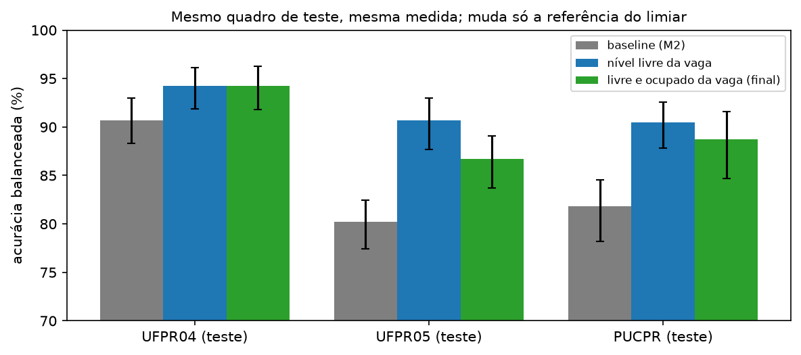
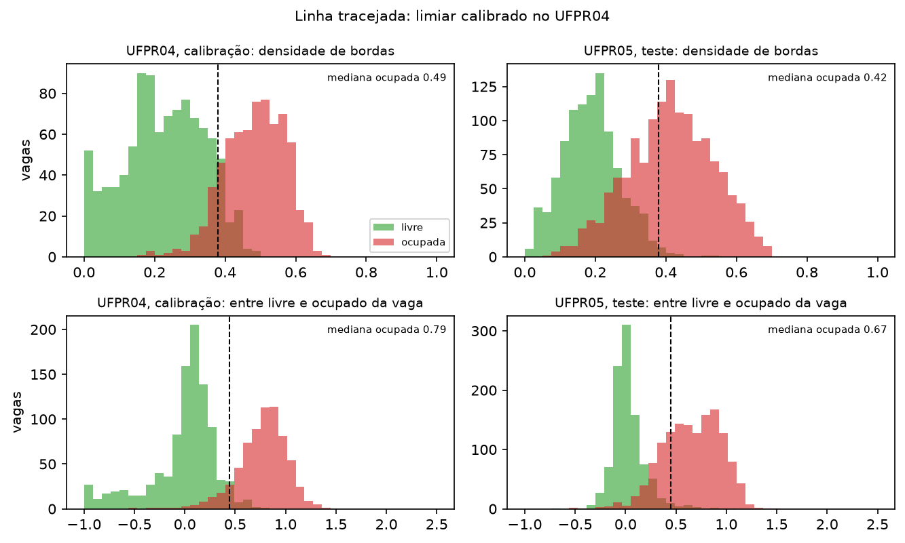
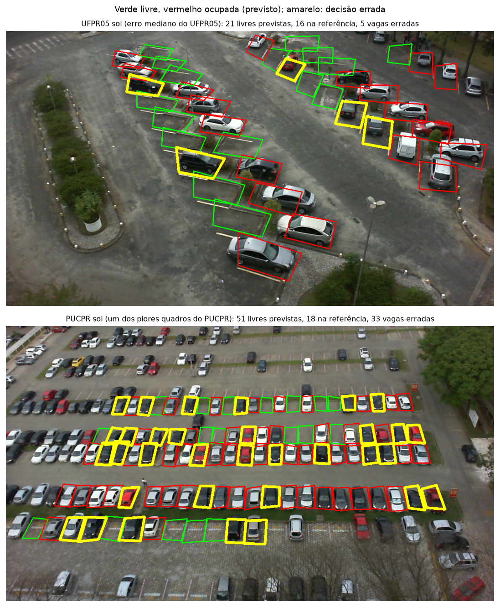
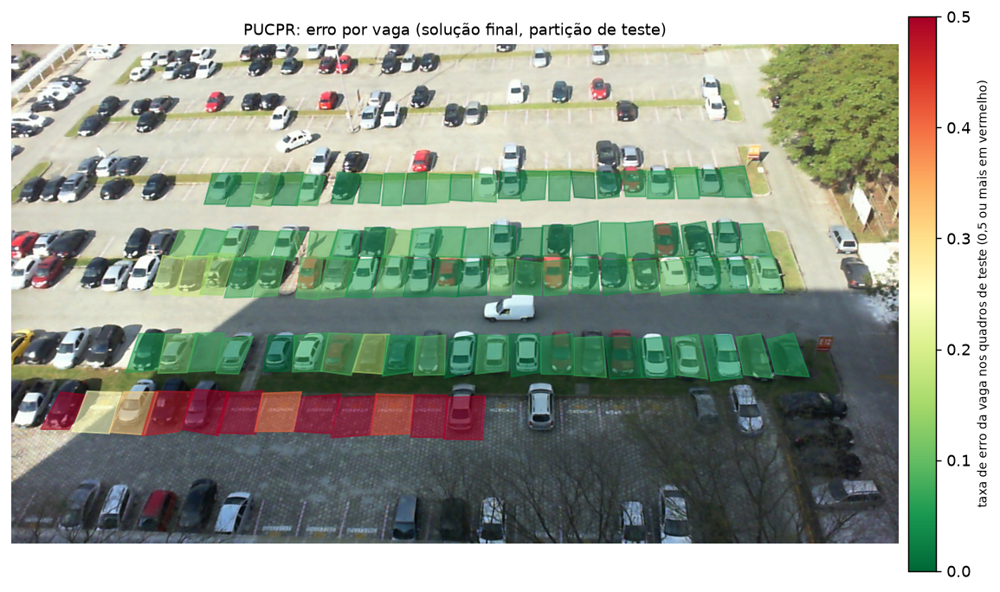

# Relatório final (M3)

Processamento de Imagens, 2026/02
Leonardo Pacheco (equipe de uma pessoa)

Versões anteriores: [`proposta.md`](proposta.md) (M1), [`relatorio_m2.md`](relatorio_m2.md) (M2).
Dados: [`dados.md`](dados.md).

## 1. Problema, objetivos e escopo final

Estacionamentos grandes querem mostrar quantas vagas estão livres usando as câmeras que já têm.
O projeto classifica cada vaga como ocupada ou livre a partir de uma câmera fixa, com uma regra
explícita `medida > limiar` e sem treinar modelo. A pergunta desde a M1 é se dá pra fazer a mesma
regra funcionar em outro clima e em outro estacionamento.

**Escopo entregue:** um comando que recebe um quadro e o XML com os polígonos das vagas e devolve
o estado de cada vaga, a contagem de vagas livres e uma imagem com as vagas coloridas. Toda a
avaliação usa o PKLot, com o limiar calibrado no UFPR04 e testado em outros dias do UFPR04 e nos
estacionamentos UFPR05 e PUCPR.

**O que mudou em relação à proposta:**

- A medida alternativa do objetivo 5 foi a região segmentada por morfologia (E4), no lugar de
  variância e energia de textura.
- A solução final não é uma normalização fotométrica, como a proposta imaginava, e sim um limiar
  relativo a cada vaga, aprendido sem rótulo pelo histórico da própria vaga (E6). Isso veio dos
  resultados da M2: a normalização só ajudou na chuva e o erro principal era a medida mudar de
  escala de um lugar pro outro.
- A saída tem um valor por vaga (a medida já reescalada) no lugar do "escore de confiança". Quanto
  mais longe do limiar, mais segura a decisão.

## 2. Fundamentação

- **Recorte com homografia:** cada vaga anotada é levada para um retângulo de 48x64, o que deixa
  vagas perto e longe da câmera comparáveis (Gonzalez e Woods, cap. de transformações
  geométricas).
- **Densidade de bordas (Sobel):** um carro tem contornos, para-brisa e faróis, e o asfalto vazio
  é mais liso. A medida é a fração de pixels com magnitude do gradiente acima de 60.
- **CLAHE e alongamento de contraste (E3):** equalização local com limite de contraste
  (Zuiderveld, 1994) e esticar os percentis 2 a 98.
- **Morfologia e componentes (E4):** fechamento, abertura e maior componente 8-conectado sobre o
  mapa de bordas.
- **Limiar relativo à vaga (E6):** como a câmera é fixa, cada vaga é vista centenas de vezes.
  Durante esse tempo ela fica livre e ocupada, então percentis baixos e altos da sua medida
  estimam como ela é livre e como é ocupada, sem precisar de rótulo. A medida de cada quadro é
  colocada entre esses dois níveis, e só aí entra o limiar global.
- **Intervalo por bootstrap** sorteando datas inteiras (Efron e Tibshirani, 1993), porque vagas do
  mesmo dia não são independentes.

## 3. Dados, referência e protocolo

PKLot (Almeida et al., 2015), licença CC BY 4.0. Detalhes, origem e como baixar em
[`dados.md`](dados.md). O conjunto não é versionado, só os 4 quadros de exemplo em `examples/`.

| Conjunto | Lotes | Quadros | Vagas | Rótulo usado? | Arquivo |
| --- | --- | ---: | ---: | --- | --- |
| Calibração | UFPR04, 15 datas | 60 | 1.677 | sim, pra escolher limiar e parâmetros | `results/split.csv` |
| Teste | UFPR04 (15 datas), UFPR05, PUCPR | 180 | 9.768 | só pra pontuar | `results/split.csv` |
| Histórico | os três, 100 por lote e clima | 900 | 49.116 | **não** | `results/history.csv` |

- **Divisão por data**, congelada na M2. O mesmo dia aparece em mais de uma pasta de clima e as
  fotos saem a cada 5 minutos, então dividir por pasta misturaria quadros quase iguais.
- **Histórico:** quadros que não estão na divisão, escolhidos espalhados no tempo. Deles só se
  leem os polígonos, nunca o rótulo. Para julgar um quadro, o histórico usado **deixa de fora a
  data desse quadro**. Para os quadros de calibração, o histórico usa só datas de calibração.
- **Referência:** o rótulo `occupied` do XML, feito pelos autores do PKLot. Só é lido depois da
  decisão. Limite: só as vagas anotadas entram, e não há rótulo de oclusão.
- **Ajuste contra avaliação:** limiar, tamanhos da morfologia e percentis do E6 foram escolhidos
  só com a calibração. O teste não foi usado pra escolher nada.
- **Métricas:** acurácia balanceada (principal, porque as classes não são iguais em todo lote),
  precisão, revocação e F1 com ocupada como positiva, FP e FN separados, e erro absoluto médio da
  contagem de vagas livres por quadro (o número que um painel mostraria). Tudo em
  `src/parking/metrics.py`.

**Representatividade:** são só três câmeras, de duas instituições em Curitiba, e todas de cima.
Não há noite, e a chuva tem poucas datas no UFPR05 e no PUCPR (8 cada).

## 4. Pipeline final e organização

```text
quadro + XML -> recorte com homografia (48x64)            extraction.py
             -> cinza e densidade de bordas (Sobel > 60)   features.py
             -> níveis livre (p20) e ocupado (p95) da vaga history.py
                no histórico, sem a data do quadro
             -> (medida - livre) / (ocupado - livre)       history.py
             -> > 0,4457 ? ocupada : livre                 inference.py
             -> JSON por vaga, contagem e imagem           scripts/infer.py
```

| Etapa do enunciado | No projeto |
| --- | --- |
| Pré-processamento | recorte com homografia e cinza. A normalização fotométrica foi testada (E3) e ficou de fora |
| Segmentação/localização | a vaga já vem localizada pelo polígono do XML. A segmentação por região foi testada (E4) e empatou, então não entrou |
| Representação/descrição | densidade de bordas, um número por vaga |
| Decisão | limiar único sobre a medida reescalada pelos níveis da vaga |

Organização: `src/parking/` tem um módulo por etapa, `scripts/` tem um script por experimento e o
comando final, `tests/` tem os testes, e `results/` e `images/results/` guardam tudo que os
scripts geram.

## 5. Decisões e parâmetros

| Parâmetro | Valor | De onde veio |
| --- | --- | --- |
| Tamanho do recorte | 48x64 | M1, proporção de uma vaga |
| Limiar de borda | 60 | M1, fixo em todas as configurações |
| Percentil livre / ocupado | 20 / 95 | varredura na calibração, `results/e6_sweep.csv` |
| Diferença mínima entre os níveis | 0,1 | fixada antes, pra uma vaga que quase não muda não virar ruído amplificado |
| Limiar final | 0,4457 | calibrado no UFPR04, maximizando a acurácia balanceada, `results/final_config.json` |
| Quadros de histórico | 100 por lote e clima | dá uns 280 valores por vaga depois de tirar a data do quadro, e mede em menos de 1 minuto |

O p20 parte da ideia de que toda vaga fica livre pelo menos uns 20% do tempo. Conferi isso depois,
com os rótulos do histórico só pra análise: nenhuma vaga avaliada fica ocupada em mais de 80% dos
quadros do histórico.

## 6. Baseline e ablação

- **Baseline:** a configuração da M2, densidade de bordas com um limiar único calibrado no UFPR04.
- **Solução final (rescale):** a mesma medida, colocada entre o nível livre e o ocupado da vaga.
- **Ablação (offset):** tira a parte da escala e fica só com a medida menos o nível livre da vaga.
  Responde se o ganho vem de conhecer o "vazio" de cada vaga ou também da escala.

As três usam os mesmos quadros, a mesma medida, o mesmo procedimento de calibração e a mesma
avaliação. Só muda a referência do limiar. A comparação é pareada contra o baseline.

```bash
python -m scripts.measure_history --data ../PKLot/PKLot
python -m scripts.space_levels
python -m scripts.evaluate --measurements results/measurements_e6.csv --output results/evaluation_e6.csv
```

Na calibração, o rescale ficou com 94,3% e o offset com 93,8%, por isso o rescale foi escolhido
como solução final antes de olhar o teste.

## 7. Resultados

### 7.1 Tabela consolidada (teste)

Acurácia balanceada [IC 95%] e erro médio da contagem de livres por quadro. As configurações do E3
e do E4 foram reavaliadas na mesma divisão (`results/evaluation.csv`), as do E6 estão em
`results/evaluation_e6.csv`.

| Configuração | UFPR04 (outros dias) | UFPR05 | PUCPR | Erro de contagem UFPR04 / UFPR05 / PUCPR |
| --- | --- | --- | --- | --- |
| Baseline (M2) | 90,7 [88,3; 93,0] | 80,2 [77,4; 82,4] | 81,8 [78,2; 84,6] | 1,9 / 9,0 / 12,4 |
| CLAHE (E3) | 87,6 [84,0; 91,8] | 77,9 [73,8; 81,2] | 79,5 [77,2; 81,5] | 2,7 / 7,2 / 12,4 |
| Stretch (E3) | 69,3 [66,0; 72,8] | 56,9 [51,8; 61,0] | 68,2 [65,7; 70,4] | 9,0 / 15,1 / 20,5 |
| Região (E4) | 88,9 [86,7; 91,7] | 81,1 [78,6; 83,0] | 80,8 [77,2; 83,7] | 2,4 / 8,5 / 12,7 |
| Offset (E6, ablação) | 94,2 [91,9; 96,1] | 90,7 [87,6; 93,0] | 90,5 [87,8; 92,6] | 1,0 / 3,6 / 8,2 |
| **Rescale (E6, final)** | **94,2 [91,8; 96,3]** | **86,7 [83,7; 89,1]** | **88,7 [84,7; 91,6]** | **1,0 / 5,7 / 9,0** |

Diferença pareada da solução final contra o baseline: +3,5 [+2,4; +4,4] no UFPR04, +6,5
[+5,5; +7,5] no UFPR05 e +6,9 [+5,6; +8,4] no PUCPR. FP e FN de cada lote e clima estão no CSV;
no UFPR05 os falsos negativos caem de 542 pra 344, e no PUCPR de 667 pra 359.



*Acurácia balanceada no teste, com intervalo de 95%. Os dois jeitos de usar o histórico da vaga
ficam acima do baseline em todos os lotes.*

### 7.2 Por que funciona



*Em cima, a medida crua: no UFPR05 a classe ocupada inteira está mais à esquerda e o limiar do
UFPR04 corta no meio dela. Embaixo, a mesma medida reescalada pela vaga: as duas classes ficam no
mesmo lugar nos dois lotes e o limiar volta a separar.*

Era o problema que a M2 tinha deixado: a medida muda de escala entre câmeras. Usar o histórico da
vaga tira essa diferença sem precisar de rótulo do lote novo.

### 7.3 Saída final

```bash
python -m scripts.infer --frame examples/PKLot/UFPR05/Sunny/2013-04-10/2013-04-10_08_25_02.jpg
```



*Saída do comando final. Em cima, o quadro do UFPR05 com o erro mediano do lote: 21 livres
previstas contra 16 reais, e os 5 erros são carros dados como livres, 4 deles escuros. Embaixo, um
dos piores quadros do PUCPR, com 33 erros, todos carros dados como livres, a maioria escuros no
asfalto escuro à tarde.*

Os 4 quadros de `examples/` foram escolhidos por regra e não a dedo: o quadro de erro mediano de
cada lote, mais esse do PUCPR como caso de falha.

| Exemplo | Livres previstas | Livres na referência | Vagas erradas |
| --- | ---: | ---: | ---: |
| UFPR04 nublado, 2013-01-19 09:00 | 27 | 28 | 1 de 28 |
| UFPR05 sol, 2013-04-10 08:25 | 21 | 16 | 5 de 40 |
| PUCPR chuva, 2012-10-25 12:53 | 54 | 57 | 9 de 100 |
| PUCPR sol, 2012-09-19 16:08 (falha) | 51 | 18 | 33 de 100 |

**Tempo:** cerca de 0,7 s por quadro no comando final, quase tudo lendo o histórico. A medida em
si leva 0,09 ms por vaga (`results/timing.csv`). Intel i5-10600KF, 32 GB, Python 3.12, OpenCV 5.0,
sem GPU.

## 8. Análise de erros e limitações

```bash
python -m scripts.e5_errors --data ../PKLot/PKLot --measurements results/measurements_e6.csv --evaluation results/evaluation_e6.csv --pipeline "none+edge_density@rescale" --prefix e6 --label "solução final"
```

- **O efeito de tamanho do UFPR05 sumiu.** Na M2 as vagas mais distantes tinham 50,1% de falso
  negativo contra 29,5%. Agora são 29,3% [20,9; 38,9] contra 23,5% [18,3; 30,7], com os
  intervalos se sobrepondo (`results/e6_by_group.csv`).
- **O bloquete do PUCPR continua errado.** O quartil das vagas maiores ainda tem 29,7% de falso
  positivo, e as piores vagas são as mesmas da M2 (#94 com 72%, #96 com 61%). Fui ver o porquê:
  nessas vagas o piso vazio tem **mais** borda que o carro (mediana 0,60 livre contra 0,46
  ocupada). A relação se inverte, e nenhuma transformação que só desloca e estica a medida resolve
  isso. Precisaria de outra medida, tipo cor ou textura orientada.



*Taxa de erro de cada vaga no teste com a solução final. A fileira de baixo, sobre bloquete,
continua vermelha.*

- **Carros escuros com pouca luz** viram falso negativo, porque quase não geram borda. É o caso
  do PUCPR à tarde da figura de saída.
- **A escala do rescale atrapalhou no lote novo.** A ablação (offset) foi melhor no teste do
  UFPR05 (90,7 contra 86,7) e do PUCPR (90,5 contra 88,7), mesmo tendo perdido na calibração. A
  explicação mais provável é que o p95 é um nível mais instável que o p20: depende de quantos
  carros grandes e claros pararam na vaga. Não troquei a solução final por isso, porque seria
  escolher a configuração pelo teste.

**Ameaças à validade:**

- O histórico do UFPR05 e do PUCPR vem das mesmas semanas do teste (de outras datas, sem rótulo).
  Numa instalação real seria preciso deixar a câmera gravando alguns dias antes de usar.
- Calibrei só no UFPR04. Não sei se as conclusões valem calibrando em outro lote.
- Três câmeras parecidas não permitem dizer que funciona em qualquer estacionamento.
- Oclusão continua sem medida, porque o PKLot não tem esse rótulo.

## 9. Atendimento aos objetivos e conclusão

| Objetivo / critério | Situação |
| --- | --- |
| 1 a 3: recorte, medida e queda entre lotes | feitos na M1, reavaliados na M2 |
| 4: normalização fotométrica | feito (E3). Ajuda só na chuva |
| 5: medida alternativa | feito com região segmentada (E4). Empatou |
| 6: erro por posição e área | feito (E5 e E6) |
| C1: ≥ 90% no mesmo lote em outros dias | atendido: acurácia de 95,7% no UFPR04 (sol 93,0, nublado 96,2, chuva 97,9) |
| C2: normalização reduz a queda entre lotes | **não atendido** pela normalização fotométrica. A queda diminuiu por outro caminho: de 10,5 pra 7,5 pontos no UFPR05 e de 8,9 pra 5,5 no PUCPR |
| C3: tudo por clima | sim, em todos os CSVs de avaliação |
| C4: FP e FN separados | sim |
| C5: reprodutível | sim, comandos abaixo, sem aleatoriedade fora do bootstrap (semente fixa) |

**Conclusão:** uma regra simples sobre bordas funciona bem no estacionamento em que foi calibrada,
mas cai em outra câmera porque a escala da medida muda. Normalizar o contraste não resolve.
Comparar cada vaga com o seu próprio histórico, sem rótulo, recupera boa parte da queda (+6,5 e
+6,9 pontos) e reduz o erro de contagem no UFPR05 de 9,0 pra 5,7 vagas por quadro. O que sobra
são casos em que a borda deixa de ser um bom sinal: piso texturizado e carro escuro com pouca luz.

**Melhorias futuras:** uma medida que não dependa só de borda pra fileira de bloquete; atualizar
os níveis da vaga continuamente em vez de um histórico fixo; testar calibrando em outro lote; e
avaliar o offset contra o rescale numa câmera nova, separada desta avaliação.

## 10. Evolução M1 → M2 → M3

| Etapa | O que foi feito | O que mudou depois |
| --- | --- | --- |
| M1 | Problema, dados, recorte com homografia (E1), densidade de bordas com limiar (E2) | A devolutiva apontou que calibração e teste estavam misturados e pediu métricas balanceadas |
| M2 | Divisão por data congelada, métricas com intervalo, comparação pareada, E3, E4 e E5, correção do `cv2.magnitude` | Mostrou que o problema era a escala da medida entre lotes, e o plano da M3 propôs o limiar por vaga |
| M3 | Limiar por vaga sem rótulo (E6), ablação, comando final, exemplos versionados, testes do comando | Este relatório |

Itens do plano da M2:

| Tarefa planejada | Situação |
| --- | --- |
| Limiar por vaga sem rótulo | feito (E6) |
| Comando que recebe um quadro e devolve a contagem | feito (`scripts/infer.py`) |
| Marcar oclusão à mão | não feito. Ficou como limitação |
| Calibrar em outro lote | não feito. Ficou como limitação |

## 11. Contribuições e uso de IA

Fiz o trabalho sozinho, em todas as etapas: dados, protocolo, código, experimentos, análise e
documentação. O histórico de commits mostra a evolução desde a M1. Declaração de uso de IA em
[`../AI_USAGE.md`](../AI_USAGE.md).

## 12. Referências e reprodução

1. ALMEIDA, P. R. L.; OLIVEIRA, L. S.; BRITTO JR., A. S.; SILVA JR., E. J.; KOERICH, A. L.
   PKLot: a robust dataset for parking lot classification. _Expert Systems with Applications_,
   v. 42, n. 11, p. 4937-4949, 2015.
2. GONZALEZ, R. C.; WOODS, R. E. Digital Image Processing. 4. ed. Pearson, 2018.
3. ZUIDERVELD, K. Contrast Limited Adaptive Histogram Equalization. In: _Graphics Gems IV_.
   Academic Press, 1994. p. 474-485.
4. EFRON, B.; TIBSHIRANI, R. J. An Introduction to the Bootstrap. Chapman & Hall, 1993.
5. Documentação do OpenCV: <https://docs.opencv.org/>

Instruções de instalação e todos os comandos estão no [`README.md`](../README.md#reprodução).
