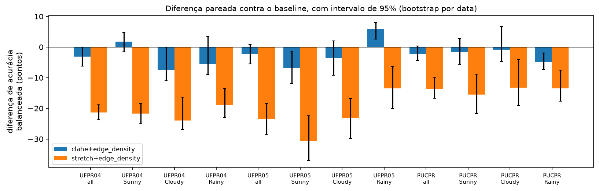
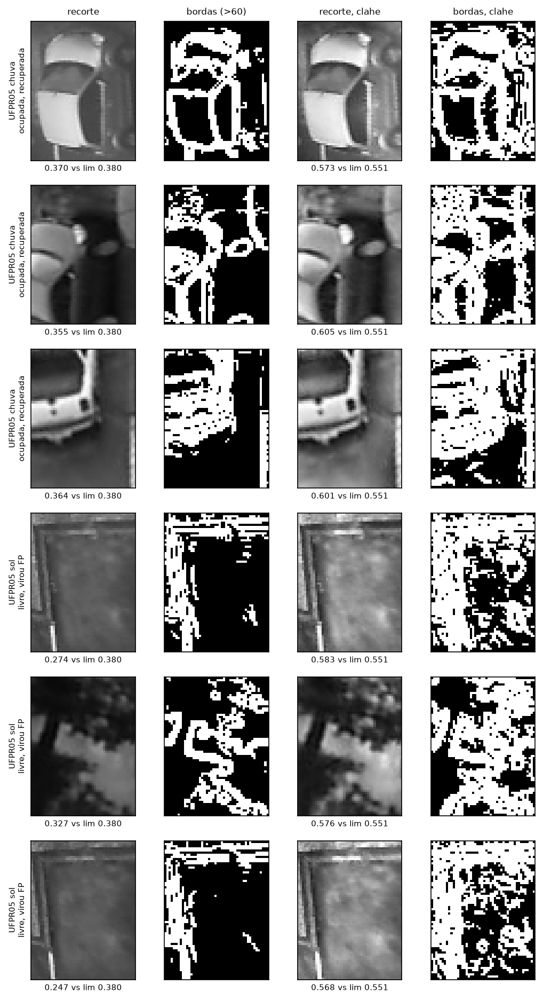
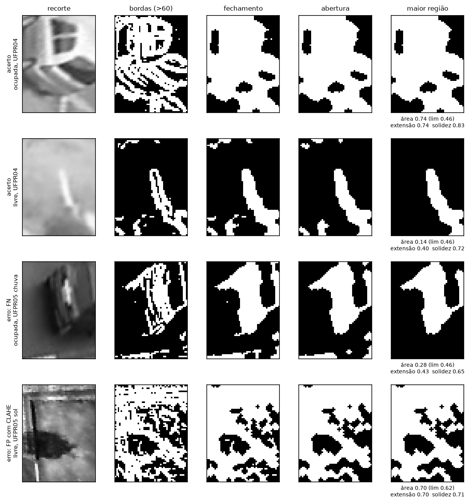
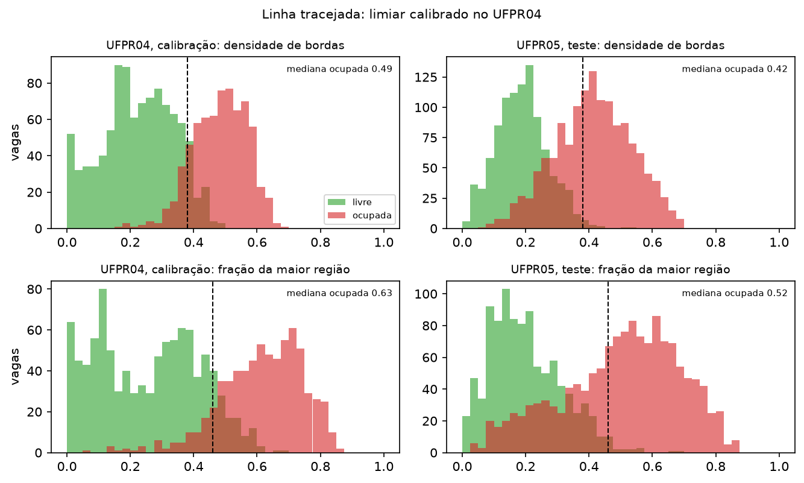
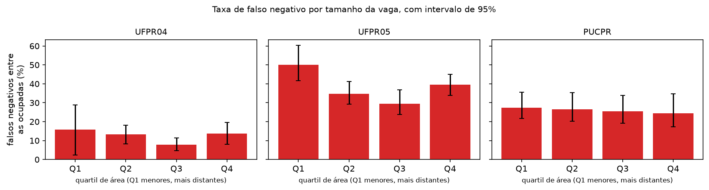
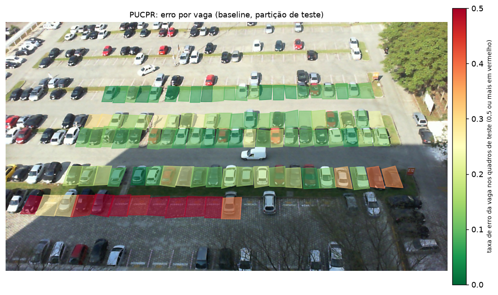

# Relatório parcial da M2

Processamento de Imagens, 2026/02
Leonardo Pacheco

Proposta e dados: [`proposta.md`](proposta.md), [`dados.md`](dados.md)

## 1. Problema e objetivos

O problema é o mesmo da M1: dizer se cada vaga está ocupada ou livre a partir de uma câmera fixa,
usando uma regra `medida > limiar`, sem treinar modelo. A pergunta também é a mesma: dá pra
processar a imagem de um jeito que a mesma regra funcione em outro clima e em outro
estacionamento?

Na M2 fiz os objetivos 4 a 6 da proposta, que viraram os experimentos E3, E4 e E5. Os critérios
de sucesso continuam os da proposta, só mudou a forma de medir.

## 2. O que mudou desde a M1 (devolutiva)

| Pedido na devolutiva                                     | O que fiz                                                                                                                           |
| -------------------------------------------------------- | ----------------------------------------------------------------------------------------------------------------------------------- |
| Congelar a divisão antes de comparar                     | Divisão por data, gerada uma vez e versionada em `results/split.csv`                                                                |
| Acurácia balanceada, precisão, revocação, F1 e intervalo | Todas no `results/evaluation.csv`. O intervalo é bootstrap sorteando datas inteiras                                                 |
| Mesma amostra e protocolo, tempo e custo                 | Todas as configurações rodam nos mesmos 240 quadros e são comparadas de forma pareada com o baseline. Tempo em `results/timing.csv` |
| Erro por área, posição e oclusão                         | Área e posição no E5. Oclusão não, o PKLot não tem esse rótulo                                                                      |
| Não partir para modelos complexos                        | Não usei nenhum classificador treinado                                                                                              |
| Prioridade para UFPR05 com chuva                         | Foi o foco do E3                                                                                                                    |

Além disso tive que corrigir duas coisas da M1:

- O E2 da M1 calibrou e avaliou nas mesmas vagas, então os 94,0% eram desempenho de ajuste. Agora
  o limiar sai só dos dias de calibração do UFPR04 e é testado nos outros dias e lotes. Os números
  das duas entregas não são diretamente comparáveis.
- O `cv2.magnitude` do OpenCV 5 dava resultados levemente diferentes entre execuções, e isso
  mudava o CSV de medidas. Troquei pela mesma conta em numpy (commit `bf24cf5`). No E2 antigo só
  o PUCPR chuva mudou, de 86,7% para 86,8%.

## 3. Dados e protocolo

Usei 240 quadros do PKLot, 20 por lote, clima e partição.

| Lote   | Partição   | Datas | Quadros | Vagas |
| ------ | ---------- | ----: | ------: | ----: |
| UFPR04 | calibração |    15 |      60 | 1.677 |
| UFPR04 | teste      |    15 |      60 | 1.674 |
| UFPR05 | teste      |    29 |      60 | 2.393 |
| PUCPR  | teste      |    33 |      60 | 5.701 |

A divisão é por data e não por pasta de clima, porque o mesmo dia aparece em mais de uma pasta e
os quadros são tirados a cada 5 minutos. Dividindo por pasta, a manhã de um dia podia cair na
calibração e a tarde no teste. No UFPR04 as datas alternam entre calibração e teste; UFPR05 e
PUCPR são só teste.

Tudo que foi escolhido olhando dados (limiar e tamanho da morfologia) usou só a calibração. Os
parâmetros das normalizações foram fixados antes de rodar.

A referência é o rótulo `occupied` do XML do PKLot, que só é lido depois de medir. O indicador
principal é a acurácia balanceada. Também olho falso positivo e falso negativo separados, e o erro
na contagem de vagas livres por quadro, que é o que apareceria num painel.

## 4. Pipeline

```text
quadro + XML -> recorte com homografia (48x64)          extraction.py (M1)
             -> normalização: nenhuma, CLAHE ou stretch  normalization.py    E3
             -> medida: densidade de bordas (Sobel > 60) features.py (M1)
                ou fração da maior região de bordas      regions.py          E4
             -> limiar calibrado -> ocupada/livre        decision.py
             -> métricas e contagem de livres            metrics.py
             -> erro por área, posição e vaga            analysis.py         E5
```

Cada combinação de normalização e medida tem um nome em `pipelines.py`, assim os scripts não
precisam mudar quando entra uma nova.

Ainda não tem um comando que receba um quadro solto e devolva a contagem de vagas livres. A
contagem já é calculada na avaliação, mas não como comando separado. Ficou para a M3.

## 5. Experimentos

Todos usam a mesma amostra. O baseline é o da M1: sem normalização e densidade de bordas.

### 5.1 Baseline reavaliado

| Teste                | Acurácia bal. [IC 95%] |  FP |  FN | Erro de contagem |
| -------------------- | ---------------------- | --: | --: | ---------------: |
| UFPR04 (outros dias) | 90,7 [88,3; 93,0]      |  71 |  64 |              1,9 |
| UFPR05               | 80,2 [77,4; 82,4]      |  10 | 542 |              9,0 |
| UFPR05 chuva         | 79,4 [73,4; 82,8]      |   0 | 231 |             11,6 |
| PUCPR                | 81,8 [78,2; 84,6]      | 326 | 667 |             12,4 |

No mesmo estacionamento em dias novos funciona bem. Nos outros lotes cai, e no UFPR05 quase todo
erro é falso negativo: o limiar do UFPR04 é alto demais lá, como já tinha aparecido na M1.

### 5.2 E3: normalizar o contraste ajuda?

Mudei só a normalização: nenhuma, CLAHE (clip 2,0, grade 4x4) e stretch (percentis 2 e 98). A
tabela mostra a diferença contra o baseline, com intervalo pareado.

| Teste        | CLAHE              | stretch              |
| ------------ | ------------------ | -------------------- |
| UFPR04       | −3,1 [−6,2; −0,0]  | −21,4 [−23,7; −18,9] |
| UFPR05       | −2,3 [−5,5; +0,9]  | −23,4 [−28,7; −18,5] |
| UFPR05 chuva | +5,8 [+2,6; +8,0]  | −13,5 [−20,0; −6,3]  |
| UFPR05 sol   | −6,8 [−11,9; −1,4] | −30,6 [−37,0; −22,4] |
| PUCPR        | −2,3 [−4,4; +0,4]  | −13,6 [−16,7; −10,0] |



_Diferença de cada normalização contra o baseline, por lote e clima._



_Em cima, carros do UFPR05 chuva que o baseline errava por pouco e o CLAHE recupera. Embaixo,
vagas livres do UFPR05 sol que viram falso positivo com CLAHE._

O CLAHE resolveu o caso que a devolutiva pediu: no UFPR05 chuva ganhou 5,8 pontos e o erro de
contagem caiu de 11,6 para 7,2 vagas por quadro. Mas onde o contraste já era bom ele piorou,
porque realça a textura do asfalto e ela vira borda. O stretch faz isso com o recorte inteiro e
piorou em tudo. Então o objetivo foi atingido só em parte: ajuda na chuva, não generaliza.

O custo é pequeno: 0,09 ms por recorte sem normalização, 0,12 com CLAHE e 0,27 com stretch.

### 5.3 E4: medir uma região em vez de contar bordas

Olhando as imagens do E3, no carro as bordas formam um contorno ligado e no asfalto ficam pontos
soltos. A ideia foi aproveitar isso: o mapa de bordas passa por fechamento, depois abertura, e
fica só o maior componente conectado. A medida é a fração do recorte que ele ocupa. O fechamento
vem antes porque a borda do carro é fina e a abertura sozinha apagaria o carro.

Os tamanhos dos elementos estruturantes saíram de uma varredura de 12 combinações só na
calibração (`results/e4_sweep.csv`): fechamento 5x5 e abertura 3x3 sem normalização, 3x3 e 3x3
com CLAHE.

| Teste  | região contra bordas | região+CLAHE contra bordas+CLAHE |
| ------ | -------------------- | -------------------------------- |
| UFPR04 | −1,8 [−2,8; −0,5]    | −0,1 [−1,3; +0,8]                |
| UFPR05 | +0,9 [+0,0; +1,7]    | +0,7 [−0,4; +1,8]                |
| PUCPR  | −1,0 [−1,8; −0,1]    | −0,3 [−0,8; +0,2]                |



_Bordas, fechamento, abertura e maior região, com área, extensão e solidez. As duas primeiras
linhas são acertos, a terceira é um carro do UFPR05 chuva que a região perde, e a quarta é asfalto
com CLAHE que vira um bloco parecido com carro._



_As duas medidas no UFPR04 e no UFPR05. A classe ocupada inteira se desloca para a esquerda no
UFPR05._

Deu empate, as diferenças ficam em até 2 pontos para os dois lados. O problema principal não era
borda espalhada, era a medida toda mudar de escala de um lote para outro. As duas medidas saem das
mesmas bordas, então as duas herdam isso.

### 5.4 E5: onde ficam os erros?

Usei o baseline na partição de teste e separei as vagas em quartis de área e de altura no quadro,
dentro de cada lote. As duas coisas acabam medindo o mesmo (correlação entre +0,93 e +0,95),
porque vaga mais baixa na imagem está mais perto e é maior.

No UFPR04 não tem diferença entre os quartis. No UFPR05 as vagas menores, mais distantes, erram
mais: 50,1% de falso negativo [41,6; 60,3] contra 29,5% [23,9; 36,9] no terceiro quartil. No
PUCPR o falso positivo chega a 36,7% nas vagas maiores, mas pelo mapa dá pra ver que é uma fileira
só, a que fica sobre bloquete. Ou seja, é o piso e não o tamanho.



_Falso negativo por quartil de área. Só o UFPR05 tem diferença clara._



_Taxa de erro de cada vaga no teste. A fileira de baixo é a do bloquete._

O mapa do UFPR05 (`images/results/e5_error_map_UFPR05.png`) mostra os piores casos no fundo à
direita, perto da vegetação, onde parece ter oclusão. As vagas com mais erro estão em
`results/e5_by_space.csv` (PUCPR #96 com 79%, UFPR05 #38 com 58%).

### 5.5 Juntando

Os três experimentos levam pro mesmo lugar: cada vaga tem o seu próprio nível de "vazio". O
bloquete tem textura mesmo vazio, a vaga distante tem pouca borda mesmo ocupada, e um limiar único
não dá conta das duas.

## 6. Limitações

- Oclusão não foi medida, só aparece nos mapas.
- Calibrei só no UFPR04. Calibrando em outro lote as conclusões entre lotes podem mudar.
- Alguns climas têm poucas datas e o intervalo fica largo, principalmente UFPR04 chuva.
- O limiar de borda (60) veio da M1 e não foi reavaliado. É igual em todas as configurações, então
  a comparação é justa, mas talvez não seja o melhor valor.
- O `timing.csv` muda a cada execução, por ser tempo de relógio.

## 7. Plano para a M3

| Tarefa                                                                                                                                | Responsável      | Evidência                                                   |
| ------------------------------------------------------------------------------------------------------------------------------------- | ---------------- | ----------------------------------------------------------- |
| Limiar por vaga, calibrado sem rótulo a partir do histórico da própria vaga (a câmera é fixa e toda vaga fica vazia em algum momento) | Leonardo Pacheco | Queda entre lotes menor que a do baseline, na mesma divisão |
| Comando que recebe um quadro e devolve rótulo por vaga, contagem de livres e imagem                                                   | Leonardo Pacheco | Comando no README com saída reproduzível                    |
| Marcar à mão uma amostra de vagas ocluídas                                                                                            | Leonardo Pacheco | Taxa de erro ocluídas contra não ocluídas                   |
| Repetir a avaliação calibrando em outro lote                                                                                          | Leonardo Pacheco | Tabela comparando as conclusões                             |
| Relatório final e vídeo                                                                                                               | Leonardo Pacheco | `docs/relatorio_m3.md` e link no README                     |

## 8. Contribuições

Fiz o trabalho sozinho, todas as etapas. Os commits da M2 começam em `bf24cf5`.

## 9. Referências

1. ALMEIDA, P. R. L.; OLIVEIRA, L. S.; BRITTO JR., A. S.; SILVA JR., E. J.; KOERICH, A. L.
   PKLot: a robust dataset for parking lot classification. _Expert Systems with Applications_,
   v. 42, n. 11, p. 4937-4949, 2015.
2. GONZALEZ, R. C.; WOODS, R. E. Digital Image Processing. 4. ed. Pearson, 2018.
3. ZUIDERVELD, K. Contrast Limited Adaptive Histogram Equalization. In: _Graphics Gems IV_.
   Academic Press, 1994. p. 474-485.
4. EFRON, B.; TIBSHIRANI, R. J. An Introduction to the Bootstrap. Chapman & Hall, 1993.
5. Documentação do OpenCV: <https://docs.opencv.org/>
